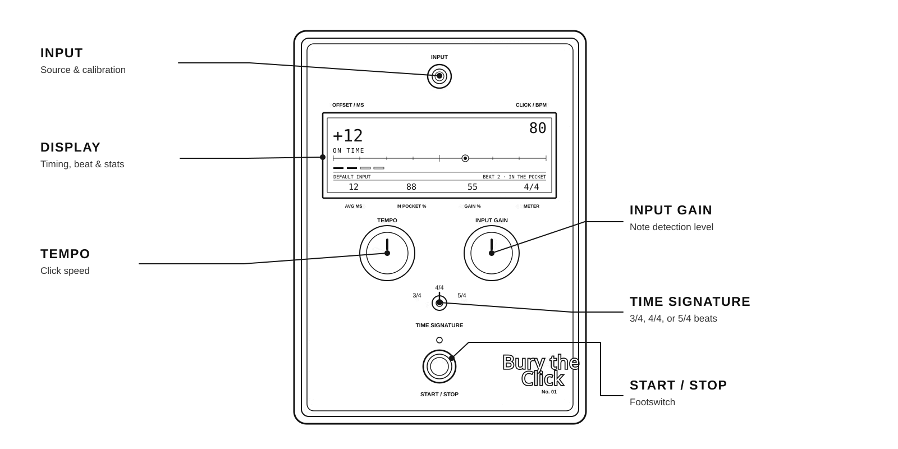

# Bury the Click

A browser-based timing pedal. It plays a click, listens to your instrument through a microphone or audio interface, and shows how early or late each note lands.



## Play

1. Connect an instrument through an audio interface or use a microphone. Put on headphones so the click does not feed back into the input.
2. Press **Input** and allow microphone access. Choose the audio source with the arrow buttons. Play a few notes to check the live input meter; if it reports clipping, lower the level on your interface.
3. Set **Tempo** and **Input Gain** by dragging each dial horizontally. Gain changes how readily a note is detected. Double-click a dial to reset it to 80 BPM or 55%.
4. Set **Time Signature** to 3/4, 4/4, or 5/4. Tap the lever to cycle states or drag it sideways. Each click is a quarter-note beat; the first beat of each measure has a higher accent.
5. Press **Start / Stop** to begin or end a session. Play one note per click. The display shows each note's offset in milliseconds, a position on the early-to-late line, and average error. **IN POCKET %** updates after each complete two-measure block with consistent playing; sparse blocks leave the previous score in place.

For a more accurate reading, open **Input** and choose **Calibrate with 8 notes**. Play one note on each click until all eight are heard. The pedal measures input delay and saves the adjustment for that audio source. **Clear** removes it.

## Run locally

```sh
npm install
npm run dev
```

Open the URL printed by Vite. Audio input requires microphone permission and either localhost or HTTPS.

To test the installable, offline-capable production build:

```sh
npm run build
npm run preview
```

Open the preview URL, then use your browser's install command. The app shell works offline after its first load; live input still needs an available audio device.

The code map and instructions for changing controls or adding another pedal are in [Architecture](docs/ARCHITECTURE.md).

## Verify

```sh
npm test
npm run build
```

Display fonts: [DSEG7 and DSEG14 Classic](https://github.com/keshikan/DSEG), licensed under SIL Open Font License 1.1. The license is in [`public/fonts/DSEG-LICENSE.txt`](public/fonts/DSEG-LICENSE.txt).

## License

The source code is [MIT licensed](LICENSE). The DSEG fonts retain their own license. Photographic and pedal-derived imagery in `public/` and `docs/` is not covered by the MIT license.
